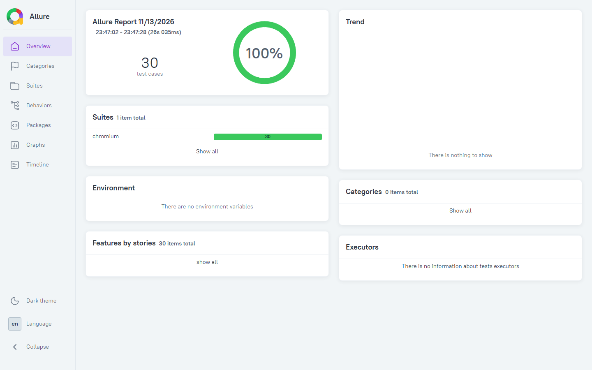

# Allure-отчёт

## Что это даёт

Allure показывает не просто «прошло/упало», а читаемую картину: шаги теста, вложения, время, распределение по наборам. Такой отчёт можно приложить к релизу и показать на собеседовании.

| | |
|---|---|
| Тестов в отчёте | 30 |
| Результат | 100% passed |
| Время прогона | ~27 секунд |



## Как запустить

```bash
npm run test:e2e          # 1. прогон тестов -> allure-results/
npm run allure:generate   # 2. генерация HTML -> allure-report/
npm run allure:open       # 3. открыть http://localhost:5050
```

## Про Java

Allure CLI — это Java-приложение. В проекте предусмотрены два варианта:

1. **Системная Java.** Если `JAVA_HOME` задан, скрипт использует её.
2. **Портативная JRE.** Положи JRE в `tools/jre/<любая папка>/bin/java.exe` — скрипт найдёт её сам, ничего в систему не устанавливается.

Скачать портативную: https://adoptium.net/temurin/releases/?version=21 (JRE, Windows x64, .zip)

## Как это устроено

| Файл | Роль |
|---|---|
| `playwright.config.js` | репортер `allure-playwright` с `resultsDir: 'allure-results'` |
| `scripts/allure-report.mjs` | поиск JRE, подстановка `JAVA_HOME` и `java.io.tmpdir`, вызов Allure CLI |
| `scripts/allure-open.mjs` | локальный статический сервер на 5050 |

`allure-results/` и `allure-report/` в `.gitignore` — это артефакты прогона, а не исходники.

## В CI

Job `e2e-tests` после прогона тестов генерирует отчёт и прикладывает его артефактом `allure-report`. Скачивается со страницы прогона в GitHub Actions.

## Полезные возможности

- **Steps** — разбить тест на шаги через `test.step('...', async () => {...})`
- **Attachments** — прикреплять JSON ответов API
- **Labels** — `severity`, `owner`, `feature` для группировки
- **История** — при накоплении прогонов строится тренд (нужен allure-history)
